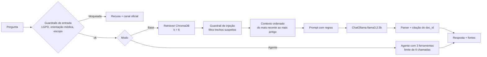

# Assistente de vacinação contra a gripe (CitizenTech · GS 2026.2)

Trabalho da Global Solution 2026.2 · Ciência da Computação · disciplina **Prompt and Artificial Intelligence** · turma 1CCPH
Integrantes: Kethelyn Rocha (RM 574016) e Anna Luiza Carvalhaes (RM 573330)
Frente escolhida: **D – Serviço público essencial** (saúde pública: vacinação contra a gripe)

## O que é

Um assistente que responde dúvidas simples sobre vacinação contra a gripe em um município **fictício** (Vila Serena): quem pode se vacinar, que documentos levar, até que horas cada unidade atende e onde há acessibilidade. Ele só responde com base em uma base de documentos própria, cita de qual documento tirou a informação e diz "não há informação na base" quando não sabe.

Ele **não é um canal oficial** e **não dá orientação médica**.

## Como o pipeline funciona

Em texto: documento → chunk → índice (ChromaDB) → retriever → filtro de injeção → prompt → LLM → resposta com `doc_id`. No modo agente, o modelo escolhe uma ferramenta e o código calcula a resposta.

## Como rodar

1. Abra `1_Notebook_GS2026_2.ipynb` no Google Colab e ligue a GPU (Runtime → Change runtime type → T4).
2. Rode tudo em Runtime → Run all.
3. Nenhuma API paga é usada: os modelos rodam localmente no Colab com Ollama (`llama3.2:3b` para o RAG e o agente, `nomic-embed-text` para embeddings, `llama3.1:8b` como juiz do RAGAS).
4. Se você quiser usar o Ollama Cloud, crie o Secret `OLLAMA_API_KEY` no Colab. **A chave nunca fica escrita no notebook.**
5. Na Seção 7, o `ground_truth` das 8 perguntas precisa estar preenchido antes de rodar o RAGAS.
6. Versões das bibliotecas usadas na execução (impressas pela última célula do notebook): langchain 1.4.8, langchain-core 1.8.3, langchain-community 0.4.2, langchain-ollama 1.1.0, langchain-chroma 1.1.0, chromadb 1.5.9, gradio 6.31.0, ragas 0.4.4 e pandas 2.2.3. Para repetir a execução com as mesmas versões: `pip install langchain==1.4.8 langchain-core==1.8.3 langchain-community==0.4.2 langchain-ollama==1.1.0 langchain-chroma==1.1.0 chromadb==1.5.9 gradio==6.31.0 ragas==0.4.4`.

## Base documental e armadilha

São 5 documentos fictícios escritos pelo grupo (nada foi copiado da internet), em `2_base_documental/`. Cada um tem `titulo`, `data_publicacao` e `tema`.

| Documento | Data | O que traz |
|---|---|---|
| doc_01 protocolo da gripe | 14/04/2026 | grupos prioritários, horário regular (seg a sex, 8h às 17h), documentos |
| doc_02 horário ampliado | 18/09/2026 | UBS Jardim das Palmeiras até 20h às terças e quintas, de 22/09 a 30/11 |
| doc_03 nota técnica 12/2026 | 20/10/2026 | vacina para todos com 6 meses ou mais, até 31/12/2026 |
| doc_04 sala fechada | 12/11/2026 | Jardim das Palmeiras fechada de 23 a 27/11 |
| doc_05 guia das unidades | 02/11/2026 | cinco UBS, regiões, acessibilidade e vacina em casa |

**Armadilhas (o que o sistema precisa acertar):**
- **Desatualização:** o doc_03 substitui a lista de grupos do doc_01. Quem tem 35 anos pode se vacinar depois de 20/10/2026.
- **Contradição:** o doc_02 diz que a sala funciona até as 20h nas terças e quintas até 30/11, mas o doc_04 (mais novo) fecha a sala em 24 e 26/11.
- **Faixa condicional:** a ampliação do doc_03 vale só até 31/12/2026 e enquanto durarem os estoques. O horário ampliado vale só em uma unidade.
- **Detalhes escondidos:** as senhas só até 19h30 (doc_02, 3º parágrafo) e a vacina em casa na UBS Centro (doc_05).

## Decisões técnicas

- **Chunking:** comparamos A (350 caracteres, sem sobreposição) e B (900 caracteres, sobreposição de 90). A gerou 26 chunks e B gerou 10. As duas acharam o detalhe escondido (hora da senha) na posição 1. Na armadilha do público ampliado, A achou o trecho na posição 2 e B na posição 4. Escolhemos A.
- **k do retriever = 6:** os fatos das armadilhas ficam em documentos diferentes, então buscamos mais trechos que o padrão. O context_recall médio foi 0,82, e em 6 das 8 perguntas ele foi 1,00. Isso indica que k = 6 traz os trechos necessários na maioria dos casos.
- **Documento mais recente primeiro:** o contexto é ordenado pela `data_publicacao` e o prompt manda usar o mais novo quando há contradição.
- **Modelo pequeno e local:** `llama3.2:3b`. É grátis e roda no Colab, mas erra mais do que um modelo grande.
- **Agente:** 3 ferramentas (`consultar_unidade`, `verificar_atendimento`, `verificar_elegibilidade`). As duas últimas **calculam** (datas, dias da semana e regras). O modelo decide quando chamar e o código decide o que responder. Limite de 6 chamadas por pergunta e erros controlados (unidade inexistente, hora ou data inválida).

## Guardrails

| Guardrail | O que faz |
|---|---|
| Escopo | recusa assunto fora de vacinação e recusa pedidos de orientação médica (febre, reação, medicamento) |
| Prompt injection na fonte | bloqueia trechos de documentos que mandam o modelo ignorar as regras |
| LGPD | recusa pedido de dados de outras pessoas e avisa quando a pergunta tem CPF, cartão SUS, e-mail ou telefone |
| Limite de confiança | quando o contexto não tem a resposta, responde "Não há informação na base para responder a isso." |
| Teste automático | célula com `assert` que testa todos os guardrails e confere que nenhum documento real é bloqueado |

## Avaliação com RAGAS

8 perguntas (4 simples e 4 de armadilha), com `ground_truth` escrito por nós. Os resultados completos estão em `3_avaliacao_ragas.json`, gerado pelo próprio notebook.

**Configuração:** RAG com `llama3.2:3b`, chunking A (350 caracteres), k = 6. Juiz do RAGAS: `llama3.1:8b`. Embeddings: `nomic-embed-text`. Tudo roda localmente. Como o juiz é um modelo pequeno, os valores servem como comparativo e não como valor absoluto.

| Métrica | Média | Meta |
|---|---|---|
| faithfulness | 0,19 | ≥ 0,80 |
| answer_relevancy | 0,31 | ≥ 0,75 |
| context_precision | 0,60 | ≥ 0,70 |
| context_recall | 0,82 | ≥ 0,70 |

| Nível | faithfulness | answer_relevancy | context_precision | context_recall |
|---|---|---|---|---|
| Simples (4) | 0,31 | 0,44 | 0,75 | 0,89 |
| Armadilha (4) | 0,06 | 0,18 | 0,46 | 0,75 |

| Pergunta | O que o RAG respondeu | faith. | relev. | prec. | recall |
|---|---|---|---|---|---|
| S1 documentos | respondeu (documento com foto e cartão) | 0,50 | 0,57 | 1,00 | 1,00 |
| S2 vacina em casa | respondeu (UBS Centro, agendamento na UBS) | 0,75 | 0,55 | 0,50 | 0,57 |
| S3 horário de terça | respondeu (até as 20h) | 0,00 | 0,64 | 0,50 | 1,00 |
| S4 hora da senha | "não há informação" | 0,00 | 0,00 | 1,00 | 1,00 |
| A1 35 anos | "não há informação" | 0,00 | 0,00 | 0,50 | 1,00 |
| A2 terça 24/11 | "não há informação" | 0,00 | 0,00 | 1,00 | 1,00 |
| A3 até quando | respondeu (6 meses ou mais) | 0,25 | 0,70 | 0,00 | 0,00 |
| A4 Vila Esperança | "não há informação" | 0,00 | 0,00 | 0,33 | 1,00 |

As médias por nível foram calculadas a partir desta tabela.

### Por que os números ficaram assim

1. **A busca funcionou melhor do que a resposta.** O context_recall foi o único acima da meta (0,82), e em 6 das 8 perguntas ele foi 1,00. Já faithfulness (0,19) e answer_relevancy (0,31) ficaram bem abaixo das metas.
2. **O modelo disse "não há informação" em 4 das 8 perguntas** (S4, A1, A2 e A4), mesmo com context_recall de 1,00 nas quatro. Ou seja, o trecho certo foi recuperado, mas o modelo não usou. Nossa hipótese, que não verificamos, é que o `llama3.2:3b` ficou conservador com as regras do prompt, principalmente quando precisa comparar datas, horários e unidades.
3. **Os quatro zeros de answer_relevancy são exatamente essas quatro recusas.** O RAGAS dá nota zero para respostas evasivas. Então esse zero mede a recusa indevida, e não uma resposta errada. O faithfulness 0,00 nas mesmas quatro perguntas tem a mesma origem.
4. **As armadilhas ficaram pior do que as perguntas simples** (faithfulness 0,06 contra 0,31). Elas exigem juntar documentos e comparar datas, o que um modelo de 3b faz com dificuldade.
5. **S2 e A3: o problema é o nosso ground truth.** O ground truth de S2 diz que o pedido é feito por formulário no site da prefeitura, e o de A3 fala em Ministério da Saúde e em "final do ano vigente". Nenhuma dessas informações está nos documentos. Isso explica o context_recall de 0,57 em S2 e de 0,00 em A3, e o context_precision de 0,00 em A3. Nas duas, o RAG respondeu com o que está na base (UBS Centro com agendamento na própria UBS; vacina para 6 meses ou mais). Fica como limitação do nosso conjunto de perguntas.
6. **S3 foi respondida certo** (até as 20h, citando o doc_02), mas ficou com faithfulness 0,00. Nossa hipótese é que isso seja limitação do juiz pequeno, e não do RAG, mas não conseguimos verificar.

### Melhoria proposta

Reduzir as recusas indevidas, que são o maior problema medido: 4 de 8 respostas, com faithfulness médio de 0,19 e answer_relevancy de 0,31. A proposta tem dois passos:
- reescrever a regra 5 do prompt para só responder "não há informação" quando nenhum trecho do contexto trata do assunto, e incluir 2 exemplos de resposta com data e horário;
- rodar de novo e comparar com esta primeira rodada: a meta é ter no máximo 1 recusa em 8 e faithfulness acima de 0,5.

Se não houver melhora com o prompt, o passo seguinte é testar um modelo maior para o RAG.

## Limitações

- A base é fictícia e pequena (5 documentos). Em produção, seriam documentos oficiais, atualizados.
- O modelo é pequeno e pode errar, principalmente quando junta dois documentos.
- As ferramentas têm as regras escritas no código (copiadas dos documentos). Se um documento mudar, o código precisa mudar junto.
- A ferramenta de horário não conhece feriados.
- Não houve revisão jurídica nem de profissionais de saúde.

## Custo aproximado

- Modo base (RAG): 1 chamada de embedding e 1 de geração por pergunta.
- Modo agente: até 6 chamadas ao modelo por pergunta.
- RAGAS: dezenas de chamadas ao juiz por pergunta. É a parte mais lenta do notebook.

## Uso de IA

Usamos o Claude como apoio para rascunhar a base documental fictícia, o código e este README. Revisamos tudo. O `ground_truth` do RAGAS foi escrito por nós. O registro está em `6_Chat_Log.txt`.
